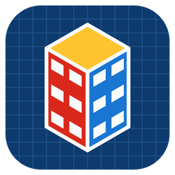

<p align="center">
  
</p>

# MonBIM 2026

**Монгол** · [English](#english)

MonBIM бол Монголын инженер, архитекторуудад зориулсан барилгын мэдээллийн загварчлалын (BIM) програм. Хана, шал,
тааз, дээвэр, хаалга цонх, шат, багана, дам нуруу, арматур, сантехник, цахилгааны сүлжээг 3D загвараар байгуулж, план,
зүсэлт, фасад, хүснэгт (schedule), хуудсыг (PDF) гаргана. IFC (IFC2x3, IFC4) болон Revit-ийн `.rvt` файлыг уншиж, IFC,
DWG/DXF, glTF рүү гаргана. MonBIM бол [BIMCraft](https://github.com/IPedrax/BIMCraft)-ийн монгол/англи хувилбар
(MIT OR Apache-2.0).

### Суулгах (Windows)

**[MonBIM 2026 татах (Windows)](https://monhydro.com/downloads/MonBIM-2026-Setup.exe)** · [бүх хувилбар](https://github.com/Mandakha1/monbim/releases)

- `monbim-2026-<хувилбар>-windows-x64-setup.exe` — администраторын эрх шаардлагагүй, `%LOCALAPPDATA%\Programs\MonBIM`
  руу суулгана. Start цэсэнд **MonBIM 2026** ба **MonBIM 2026 (AI)** гарч ирнэ.
- Чимээгүй суулгах: `monbim-2026-<хувилбар>-windows-x64-setup.exe /S` (ширээний товчлолтой: `/S /DESKTOP=1`).
- Суулгахгүйгээр ажиллуулах: `monbim-2026-<хувилбар>-windows-x64-portable.zip`-ийг задлаад `monbim.exe`.
- Тохиргоо `%APPDATA%\MonBIM` хавтаст хадгалагдана: BIMCraft суусан байсан ч тохиргоо нь холилдохгүй.

### Хэл

File › Settings › User Interface › Language › **Монгол**. Цэс, цонх, товч бүгд монголоор. Зургийн (план, хуудас) бичиг нь кирилл үсэггүй тул шинэ төсөл англи нэртэй (Level 1, Level 2) эхэлнэ.

### AI-тай холбох (Claude, ChatGPT, Codex)

Start цэснээс **MonBIM 2026 (AI)**-г нээгээд (`monbim.exe --control 7676`), AI програмд дараах MCP серверийг нэмнэ:

```
claude mcp add monbim -- "%LOCALAPPDATA%\Programs\MonBIM\monbim-cli.exe" mcp --connect 7676
```

Суулгасан хавтас дахь `AI-connect.txt` файлд Claude Desktop, ChatGPT, Codex-д зориулсан бэлэн тушаалууд бий.

### Мэдээ, бүртгэл

Програм эхлэхдээ MonHydro-гийн мэдээ, сургалтын жагсаалтыг уншиж (File › Help › Мэдээ, сургалт…), анх удаа Gmail-ээр
нэг удаа нэвтрэхийг хүснэ (File › Help › Бүртгэл…). `MON_NEWS=0`, `MON_ACCOUNT=0` орчны хувьсагч тэдгээрийг унтраана.
Юу хадгалдаг, яаж устгуулах: [нууцлал](https://monhydro.com/legal.html#apps). Шинэ хувилбар гарвал програм эхлэхдээ мэдэгдэнэ
(File › Check for updates at startup унтраана).

---

<a id="english"></a>

**English**

MonBIM 2026 is a Mongolian/English edition of [BIMCraft](https://github.com/IPedrax/BIMCraft), the clean-room, pure-Rust BIM
application that follows the Revit workflow, made for Mongolian engineers: walls, floors, roofs, doors and windows, stairs,
structure and MEP in 3D; plans, sections, schedules and sheets; IFC and Revit `.rvt` in, IFC, DWG/DXF, glTF and PDF out. Its
files are BIMCraft's: a `.bimc` project or a `.bimf` family opens in either program.

What MonBIM changes, and where, is in [docs/monbim/FORK.md](docs/monbim/FORK.md). BIMCraft's own README, with the full feature
list, the commands and the architecture, is kept in [docs/upstream/BIMCraft-README.md](docs/upstream/BIMCraft-README.md).

### Install (Windows)

**[Download MonBIM 2026 for Windows](https://monhydro.com/downloads/MonBIM-2026-Setup.exe)** · [all releases](https://github.com/Mandakha1/monbim/releases)

- `monbim-2026-<version>-windows-x64-setup.exe`: a per-user install to `%LOCALAPPDATA%\Programs\MonBIM`, no administrator
  rights; Start menu entries **MonBIM 2026** and **MonBIM 2026 (AI)**. Silent: `/S` (add `/DESKTOP=1` for a desktop shortcut).
- `monbim-2026-<version>-windows-x64-portable.zip`: unzip and run `monbim.exe`.
- Settings live in `%APPDATA%\MonBIM` (`~/Library/Application Support/MonBIM`, `~/.config/monbim`), never shared with an
  installed BIMCraft.

### Build

```sh
cargo build --release -p bimcraft -p bimcraft-cli   # target/release/monbim and monbim-cli
packaging/monbim/build-windows.sh                    # from macOS or Linux: the Windows installer and portable zip
```

The package names stay upstream's (`bimcraft`, `bimcraft-cli`) so merges from BIMCraft stay small; the executables are
`monbim` and `monbim-cli`. Before a change is finished: `cargo fmt --check`, `cargo clippy --workspace --all-targets -- -D
warnings`, `cargo test --workspace` (see [CLAUDE.md](CLAUDE.md)).

### Agents (MCP)

`monbim-cli mcp` is an MCP server on stdio, on a project of its own; `monbim-cli mcp --connect PORT` works on the project open
in a window started with `monbim --control PORT` (the "(AI)" shortcut uses 7676). `--read-only` lets the agent only read.

### News and account

When it starts, MonBIM reads MonHydro's news and courses feed (File › Help › News and courses…) and asks for a one-time Gmail
sign-in at monhydro.com (File › Help › Account…). `MON_NEWS=0` and `MON_ACCOUNT=0` turn them off. What is kept, and how to have it
deleted: [privacy](https://monhydro.com/legal.html#apps). A new release is announced when MonBIM starts (File › Check for updates
at startup turns that off).

### Licence and credits

MonBIM is a modified version of BIMCraft by IPedrax and the BIMCraft contributors, dual-licensed under [MIT](LICENSE-MIT) or
[Apache-2.0](LICENSE-APACHE), at your option; MonBIM's own changes are under the same terms. The Revit file reader
([`crates/rvt`](crates/rvt)) holds code ported from rvt-rs and is Apache-2.0 only, and it is on by default, so **a build that
includes it is distributed under Apache-2.0**; a build with `--no-default-features` is MIT OR Apache-2.0. The interface is
lettered in IBM Plex (SIL Open Font License 1.1). Every notice is in [NOTICE](NOTICE).

MonBIM is not affiliated with or endorsed by BIMCraft's authors. Autodesk and Revit are trademarks or registered trademarks of
Autodesk, Inc.; MonBIM is not affiliated with, sponsored by or endorsed by Autodesk, Inc. IFC is an open standard of
buildingSMART International (ISO 16739).
